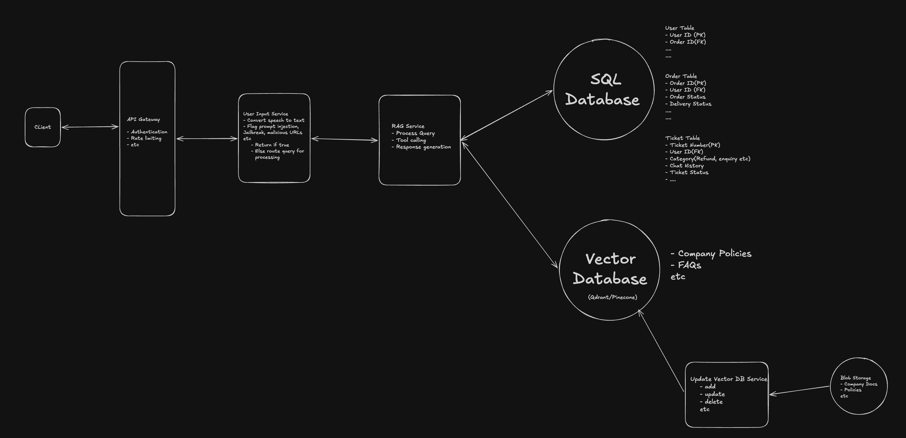

# customer-support-agent
It contain `pseudo code` for a customer support agent.
#### Capabilities/Features    
    1. Accept both voice & text input
    2. Track food delivery
    3. Issue Refund
    4. Track & provide transaction/order history

### Architecture

### Folder Structure

    UserService
        - Service       // Process sanitize user inputs(voice,text), and outputs
    RAGService
        - utils         // Utility functions
        - build_agents  // Agent config
        - service       // Process user query(ReACT loop)
    VectorDB
        - Service.py    // Create, update, vector DB
    assets
        - diagram.png   // Architecture

### OverView
    Service 1: User Service (Entry point, validation, sanitization, etc)
    Service 2: RAG Service (Process Query and generate response, tool calling etc.)
    Service 3: VectorDB (Scheduled Job for adding, updating new documents in database)